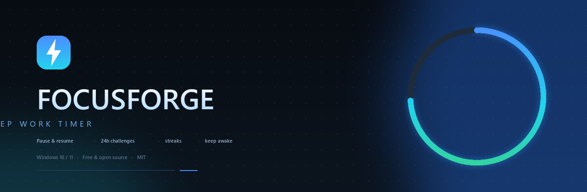
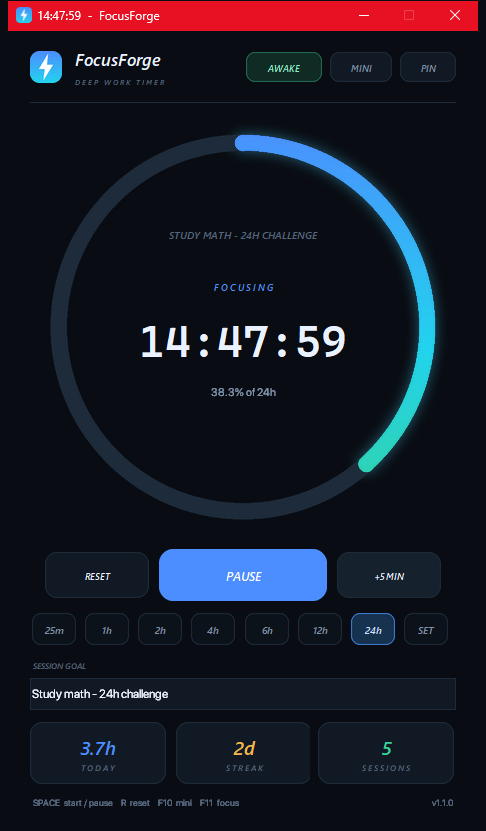
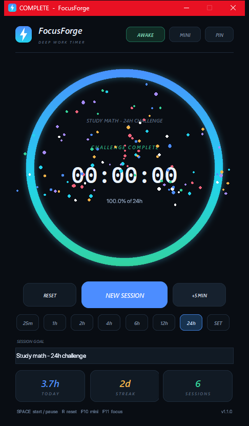
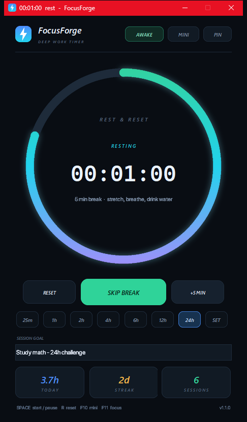
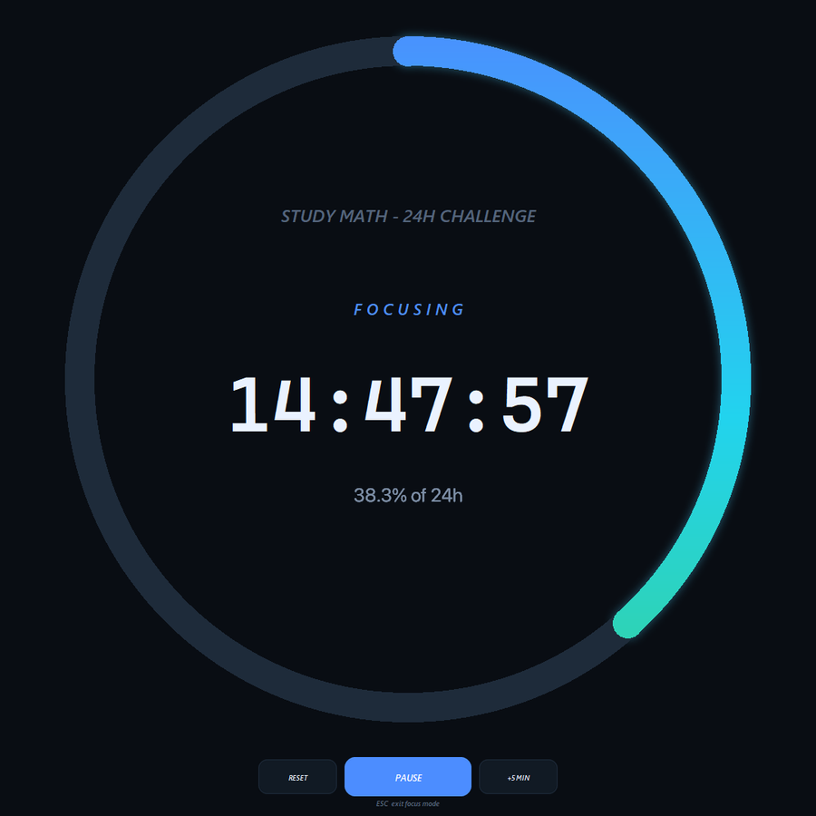
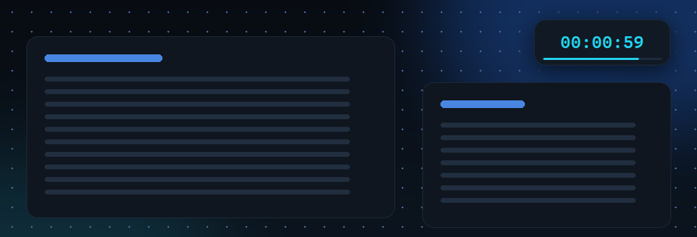

<p align="center">
  <a href="https://github.com/real-pakdragon/FocusForge/releases/latest">
    
  </a>
</p>

<h3 align="center">A dark, distraction-free timer for long study challenges.</h3>

<p align="center">
  From a 25 minute pomodoro to a full 24 hour marathon — pause anytime,<br>
  keep your PC awake, and watch your streak grow.
</p>

<p align="center">
  
  <a href="https://github.com/real-pakdragon/FocusForge/releases/latest"></a>
  <a href="https://github.com/real-pakdragon/FocusForge/releases"></a>
  
</p>

<p align="center">
  <a href="#download"><b>Download</b></a> &nbsp;·&nbsp;
  <a href="#features">Features</a> &nbsp;·&nbsp;
  <a href="#screenshots">Screenshots</a> &nbsp;·&nbsp;
  <a href="#build-from-source">Build</a> &nbsp;·&nbsp;
  <a href="#faq">FAQ</a>
</p>

---

## Download

| | |
| :--- | :--- |
| **Installer** &nbsp;·&nbsp; recommended | **Portable** |
| [**`FocusForge-Setup-1.1.0.exe`**](https://github.com/real-pakdragon/FocusForge/releases/latest/download/FocusForge-Setup-1.1.0.exe) | [**`FocusForge.exe`**](https://github.com/real-pakdragon/FocusForge/releases/latest/download/FocusForge.exe) |
| 32 MB — installs per-user, **no admin rights**, adds Desktop + Start Menu shortcuts and a real uninstaller. | 30 MB — a single self-contained file. Double-click and go, no installation. |

> **Windows SmartScreen:** the builds are not code-signed yet, so Windows may show
> *"Windows protected your PC"* on first run. Click **More info → Run anyway**.
> You can verify what you downloaded against the SHA-256 checksums in the release notes.

**Requirements:** Windows 10 or 11 (64-bit). No Python, no .NET, no runtime to install.

## Features

| | |
| :--- | :--- |
| ⏱️ **Any challenge length** — presets for 25m, 1h, 2h, 4h, 6h, 12h and 24h, plus any custom duration from 1 minute to 168 hours. | ⏸️ **Pause, resume, reset** — one click or the space bar. Elapsed time is preserved exactly, even after hours. |
| ➕ **+5 minute top-up** — extend a running challenge without losing progress. | 🎯 **Session goal** — type what you're working on and it is shown inside the ring. |
| 🌀 **Animated progress ring** — anti-aliased gradient ring with a soft glow and rounded end caps. | 📊 **Live stats** — today's focus time, day streak and completed sessions, saved between launches. |
| 💡 **Keep awake** — stops Windows from sleeping or blanking the screen while the timer runs. | 📌 **Always on top** — keeps the timer above your notes and textbooks. |
| 🖥️ **Focus mode** — `F11` turns the app into a fullscreen clock with everything else hidden. | 🎆 **Firework finish** — a synthesised launch whistle, boom and crackle plus confetti and a taskbar flash. |
| ☕ **Automatic 5 minute rest** — when a challenge completes, a mint rest ring takes over and returns you to ready when it ends. | 🎧 **No audio files** — every finish cue is generated in code, so the download stays one small executable. |
| 🪟 **Mini widget** — `F10` shrinks the timer to a small, always-on-top clock you can drag into a corner. | 🖱️ **Stays out of the way** — drag to move it, single-click to pause, double-click for the full window. |

**Milestone nudges** at 25%, 50%, 75% and 90% give you a quiet chime and a status line —
enough to notice, not enough to break concentration. During a rest you can press
`Space` (or the mint **SKIP BREAK** button) to start the next session early.

## Screenshots

<p align="center">
  
  &nbsp;
  
  &nbsp;
  
  <br>
  <em>Mid-challenge &nbsp;·&nbsp; Challenge complete &nbsp;·&nbsp; Rest timer</em>
</p>

<p align="center">
  
  <br>
  <em>Focus mode — press F11</em>
</p>

<p align="center">
  
  <br>
  <em>Mini widget — F10 shrinks the timer to a corner and keeps it always on top</em>
</p>

## Keyboard shortcuts

| Key | Action |
| :---: | :--- |
| `Space` | Start / pause / resume / skip rest |
| `R` | Reset the timer |
| `F10` or `W` | Toggle the mini widget |
| `F11` | Toggle fullscreen focus mode |
| `Esc` | Leave focus mode or the mini widget |

## Install

### Installer (recommended)

1. Download [`FocusForge-Setup-1.1.0.exe`](https://github.com/real-pakdragon/FocusForge/releases/latest).
2. Double-click it and follow the wizard — it needs **no administrator rights**.

It installs to `%LOCALAPPDATA%\Programs\FocusForge`, creates Desktop and Start Menu
shortcuts, registers FocusForge in **Settings → Apps**, and ships a real uninstaller.
A running copy is closed automatically before files are replaced, so upgrades are safe.

Unattended install:

```powershell
.\FocusForge-Setup-1.1.0.exe /VERYSILENT /SUPPRESSMSGBOXES /NORESTART
```

### Portable

Grab [`FocusForge.exe`](https://github.com/real-pakdragon/FocusForge/releases/latest/download/FocusForge.exe)
and run it from anywhere — USB stick, OneDrive folder, whatever. Settings live in
`%APPDATA%\FocusForge`, so your stats follow you even if the exe moves.

## Build from source

Requires [Python 3.10+](https://www.python.org/) on Windows. Inno Setup 6 is only
needed for the installer step and can be installed without admin rights.

```powershell
git clone https://github.com/real-pakdragon/FocusForge.git
cd FocusForge

python -m pip install pillow pyinstaller
winget install --id JRSoftware.InnoSetup --scope user

# runs the smoke test, builds dist\FocusForge.exe and release\FocusForge-Setup-1.1.0.exe
powershell -ExecutionPolicy Bypass -File .\build.ps1
```

`build.ps1` skips the installer when Inno Setup is missing, so the portable `.exe`
always builds. To compile only the installer:

```powershell
& "$env:LOCALAPPDATA\Programs\Inno Setup 6\ISCC.exe" installer.iss
```

Run straight from source while developing:

```powershell
python src\app.py          # normal app
python src\app.py --demo   # posed demo state, never writes stats
```

Regenerate the artwork and docs images:

```powershell
python tools\make_icon.py
python tools\make_banner.py
python tools\make_screenshots.py
```

## Where is my data stored?

Everything is local and human readable:

```text
%APPDATA%\FocusForge\stats.json
```

It holds your per-day focus seconds, completed sessions, goal text, last used
duration and the mini widget position. Delete the file and you start from zero —
nothing leaves your PC.

## Uninstall

Use **Settings → Apps → FocusForge → Uninstall**, or run:

```powershell
& "$env:LOCALAPPDATA\Programs\FocusForge\unins000.exe"
```

This removes the app, shortcuts and registry entry. Your stats in
`%APPDATA%\FocusForge` are deliberately kept, so reinstalling preserves your history;
delete that folder by hand for a clean slate.

## FAQ

**Does it need administrator rights?**
No. Both the installer and the app run entirely in your user profile.

**Will Windows go to sleep during a 24 hour challenge?**
Not while the timer is running and *AWAKE* is on — the app holds
`SetThreadExecutionState` to keep the system and display awake, and releases it on
pause or exit. The same applies during the automatic rest timer.

**Does the timer keep counting if the PC sleeps anyway?**
Elapsed time is computed from a monotonic clock, not by counting ticks, so a pause,
a hitch or a slow frame never makes the timer drift.

**What is the rest timer?**
As soon as a challenge completes, FocusForge waits a few seconds for the firework
and confetti to land, then flips the ring to a mint 5 minute rest countdown. Press
`Space` or **SKIP BREAK** to jump straight into the next session. When the rest ends
you hear a soft chime and the app returns to *READY*.

**Can I keep the timer small while I study?**
Yes — press `F10` (or click **MINI**) to turn the whole app into a 196×66 widget that
shows only the remaining time and a slim progress line. It is always on top, so drag
it into a screen corner and leave it there. Single-click it to start/pause,
double-click to get the full window back; its position is remembered between launches.

**Can I use it on several PCs?**
Yes. The installer is a normal per-user setup, so run it on as many machines as you
like. Stats are per-machine.

**Is there a Mac/Linux build?**
No, the UI leans on Windows APIs for the dark title bar, taskbar flash, sound and
keep-awake. The timer logic itself is pure Python.

## Project layout

```text
FocusForge/
├── src/app.py                  # the whole application (tkinter + Pillow)
├── installer.iss               # Inno Setup script -> release\FocusForge-Setup-*.exe
├── assets/                     # icon, logo, version resource, wizard artwork
├── tools/
│   ├── make_icon.py            # icon + logo
│   ├── make_banner.py          # README hero banner
│   ├── make_screenshots.py     # docs screenshots from the real UI
│   └── make_installer_art.py   # Inno Setup wizard bitmaps
├── tests/smoke_test.py         # UI + state machine smoke test
├── build.ps1                   # test, package the exe, compile the installer
├── install.ps1                 # script based per-user install (portable builds)
└── publish.ps1                 # create the GitHub repo and push
```

Build outputs:

```text
dist\FocusForge.exe                 portable single file   (~30 MB)
release\FocusForge-Setup-1.1.0.exe  installer for any PC   (~32 MB)
```

## Tech notes

The interface is drawn with `tkinter` canvases and custom Pillow-rendered images —
rounded panels, buttons and a gradient progress ring with a glow — so there are no
third-party UI frameworks and the executable stays small. Bitmaps and gradients are
cached per size, which keeps the once-a-second ring refresh in the low tens of
milliseconds even at fullscreen sizes.

The finish sound is not a bundled audio file: `build_firework_wav()` synthesises a
rising launch whistle, a low boom, crackling sparks and a sparkle tail into an
in-memory PCM buffer, then plays it through `winsound` with `SND_MEMORY`. The rest
timer uses the same technique for its closing chime, and both buffers are rendered
once in a background thread so the first completion never stutters.

## License

[MIT](LICENSE) — free to use, modify and share.

---

<p align="center"><sub>Built for people who sit down to study math for 24 hours straight.</sub></p>
